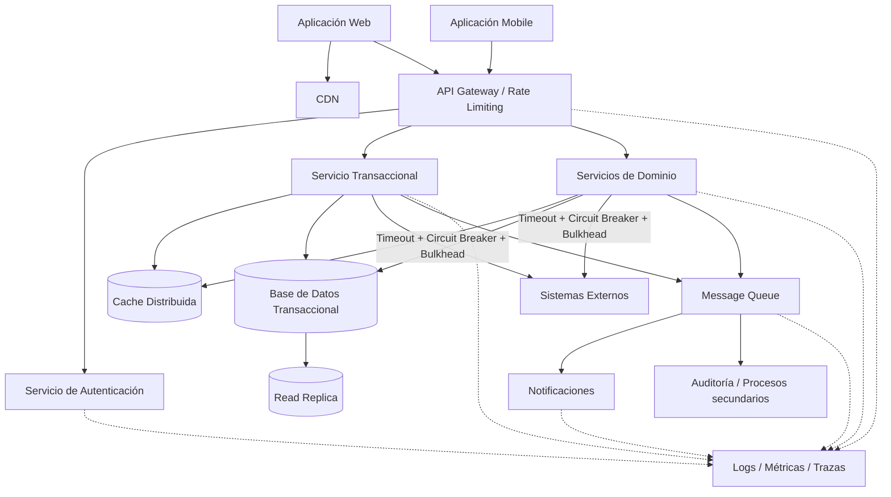

# Fase 3 — Evaluación y refinamiento de la arquitectura

## 1. Objetivo

En esta fase se evalúa la arquitectura propuesta anteriormente frente a los principales atributos de calidad definidos para el sistema:

- latencia máxima de 200 ms en operaciones mobile;
- disponibilidad mínima de 99.9 %;
- capacidad para soportar 10.000 usuarios concurrentes.

El objetivo no es asumir que la arquitectura ya cumple estos valores solamente porque fueron considerados durante el diseño.

La intención es revisar qué tan preparada está la propuesta para alcanzarlos, identificar puntos débiles, reconocer los trade-offs introducidos y realizar ajustes antes de considerar una arquitectura definitiva.

---

# 2. Evaluación contra los atributos de calidad

## 2.1 Latencia — máximo 200 ms en mobile

### ¿Cómo responde la arquitectura?

En la propuesta de la Fase 2 se tomaron varias decisiones orientadas a reducir el tiempo de respuesta:

- APIs con respuestas ligeras;
- caché para información consultada frecuentemente;
- CDN para contenido estático;
- reducción de llamadas síncronas innecesarias;
- procesamiento asíncrono para notificaciones y procesos secundarios;
- timeouts en llamadas hacia otros servicios.

También se intenta mantener corto el camino de las operaciones críticas.

Por ejemplo:

```text
Mobile
  ↓
API Gateway
  ↓
Servicio de Transacciones
  ↓
Base de datos
  ↓
Respuesta
```

Las operaciones que no necesitan participar en la respuesta inmediata se ejecutan después mediante eventos.

### ¿Cumple el objetivo?

**Potencialmente sí, pero requiere validación.**

A nivel de diseño existen mecanismos adecuados para trabajar hacia un tiempo de respuesta inferior a 200 ms.

Sin embargo, no es posible garantizarlo únicamente observando el diagrama.

La latencia final también dependerá de factores como:

- tiempo de respuesta de la base de datos;
- ubicación geográfica del usuario;
- red;
- cantidad de validaciones;
- servicios externos involucrados;
- volumen real de carga.

### Conclusión

La arquitectura está diseñada para minimizar la latencia, pero el objetivo deberá comprobarse mediante pruebas de rendimiento.

Como referencia se propone utilizar:

**p95 ≤ 200 ms**

para las operaciones mobile consideradas críticas.

Esto ofrece una medición más representativa que utilizar únicamente el promedio.

---

# 2.2 Disponibilidad — SLA 99.9 %

### ¿Cómo responde la arquitectura?

La propuesta contempla:

- múltiples instancias de servicios;
- balanceo de carga;
- health checks;
- servicios stateless;
- replicación de base de datos;
- failover;
- circuit breaker;
- timeouts;
- retries controlados;
- procesamiento asíncrono para aislar procesos secundarios.

Esto permite reducir el impacto de fallos individuales.

Por ejemplo, la caída del servicio de notificaciones no debería afectar una transacción ya procesada porque ambos componentes se encuentran desacoplados mediante una cola.

### ¿Cumple el objetivo?

**El diseño permite trabajar hacia el 99.9 %, pero debe validarse operacionalmente.**

El punto más importante es que no existe una única instancia encargada de las capacidades principales.

Aun así, disponer de redundancia no significa automáticamente alcanzar el SLA.

Será necesario validar:

- failover;
- tiempos de recuperación;
- disponibilidad de la base de datos;
- comportamiento ante caída de dependencias;
- capacidad de recuperación de la infraestructura.

### Conclusión

La arquitectura presenta una estrategia coherente de alta disponibilidad, pero el SLA debe medirse posteriormente en operación o mediante pruebas de resiliencia.

---

# 2.3 Escalabilidad — 10.000 usuarios concurrentes

### ¿Cómo responde la arquitectura?

La arquitectura propone:

- servicios stateless;
- escalamiento horizontal;
- balanceo de carga;
- auto-scaling;
- caché distribuida;
- colas para absorber picos de procesamiento;
- posibilidad de escalar servicios de forma independiente.

Estas decisiones permiten incrementar capacidad sin necesidad de rediseñar la solución completa.

Un servicio con alta demanda podría aumentar sus instancias independientemente de los demás.

### ¿Cumple el objetivo?

**Arquitectónicamente está preparada, pero debe demostrarse mediante pruebas de carga.**

Los 10.000 usuarios concurrentes son una condición importante, pero no indican por sí solos la carga total del sistema.

Por ejemplo, 10.000 usuarios conectados realizando una operación cada cinco minutos generan una carga muy distinta a 10.000 usuarios realizando operaciones simultáneamente.

Por esta razón también deberían conocerse métricas como:

- requests por segundo;
- transacciones por segundo;
- duración de los picos;
- distribución de operaciones.

### Conclusión

La estrategia de escalamiento es adecuada, pero deberán realizarse pruebas progresivas hasta alcanzar el volumen esperado y verificar que la latencia y el error rate se mantengan dentro de los valores aceptables.

---

# 3. Evaluación general

| Atributo | Estado | Evaluación |
|---|---|---|
| Latencia ≤ 200 ms | Parcialmente validado | El diseño reduce el camino crítico, pero necesita pruebas |
| Disponibilidad 99.9 % | Parcialmente validado | Hay redundancia y resiliencia, pero el SLA debe medirse |
| 10.000 usuarios concurrentes | Parcialmente validado | Permite escalamiento horizontal, pero requiere prueba de carga |

Por lo tanto, la arquitectura **no puede declararse todavía como completamente validada**, aunque presenta mecanismos adecuados para alcanzar los tres objetivos.

---

# 4. Trade-offs identificados

## 4.1 Consistencia vs disponibilidad

### Decisión

Para las operaciones financieras o transaccionales se prioriza la **consistencia fuerte**.

Para procesos secundarios, como notificaciones, puede aceptarse consistencia eventual.

### ¿Por qué?

Una transacción financiera no debería quedar en un estado ambiguo únicamente para aumentar disponibilidad.

En cambio, una notificación puede enviarse algunos segundos después sin afectar el resultado de la operación.

### Impacto

**Beneficio:**

- mayor confiabilidad en operaciones críticas.

**Costo:**

- algunas operaciones pueden requerir coordinación adicional y aumentar ligeramente su tiempo de procesamiento.

---

# 4.2 Escalabilidad vs simplicidad

### Decisión

Se propone separar capacidades en servicios en lugar de concentrar toda la solución en una única aplicación.

### ¿Por qué?

Esto permite escalar de forma independiente aquellas capacidades que reciben mayor carga.

Por ejemplo, el servicio de transacciones puede necesitar más recursos que el servicio de notificaciones.

### Impacto

**Beneficio:**

- escalabilidad;
- aislamiento de fallos;
- despliegues independientes.

**Costo:**

- mayor complejidad operativa;
- más componentes que monitorear;
- mayor necesidad de trazabilidad.

Por esta razón no se propone crear un servicio diferente para cada funcionalidad pequeña.

La separación debe responder a responsabilidades reales del negocio.

---

# 4.3 Rendimiento vs costo operacional

### Decisión

Utilizar múltiples instancias, caching y redundancia para soportar carga y disponibilidad.

### ¿Por qué?

Estas estrategias ayudan a reducir tiempos de respuesta y evitar que una sola instancia sea responsable de toda la carga.

### Impacto

**Beneficio:**

- menor riesgo de saturación;
- mejor disponibilidad;
- mejores tiempos de respuesta.

**Costo:**

- mayor consumo de infraestructura.

La capacidad deberá ajustarse según métricas reales y no simplemente mantener recursos sobredimensionados.

---

# 4.4 Seguridad vs latencia

### Decisión

Mantener validaciones de autenticación y autorización aun cuando agreguen procesamiento adicional.

### ¿Por qué?

Eliminar controles para reducir algunos milisegundos no es una alternativa aceptable.

### Impacto

La seguridad puede incrementar ligeramente el tiempo de respuesta, por lo que deberán optimizarse los mecanismos de validación sin eliminarlos.

---

# 5. Evaluación frente a principios SOLID

Aunque SOLID suele aplicarse principalmente al diseño de software y código, algunos de sus principios también son útiles para revisar la separación de responsabilidades de la arquitectura.

---

## 5.1 Single Responsibility Principle

Cada servicio debería tener una responsabilidad principal claramente definida.

En la propuesta existen capacidades separadas para:

- autenticación;
- negocio;
- transacciones;
- notificaciones.

Esto ayuda a evitar que un único componente concentre demasiadas responsabilidades.

### Área de mejora

El nombre **Servicio de Negocio** todavía es demasiado general.

A medida que se conozca mejor el dominio, sería conveniente dividirlo por capacidades reales de negocio y no mantener un servicio genérico que con el tiempo pueda convertirse en un componente demasiado grande.

---

## 5.2 Open/Closed Principle

Los servicios deberían permitir incorporar nuevas capacidades sin tener que modificar constantemente componentes existentes.

El uso de APIs y eventos ayuda a conseguirlo.

Por ejemplo, un nuevo consumidor podría suscribirse a un evento de transacción sin modificar directamente el servicio que la procesa.

### Área de mejora

Será necesario establecer una política clara de versionamiento de contratos para evitar que cambios futuros rompan consumidores existentes.

---

## 5.3 Liskov Substitution Principle

Este principio tiene menor aplicación directa a nivel de arquitectura.

Sin embargo, puede relacionarse con la capacidad de sustituir implementaciones detrás de contratos estables.

Por ejemplo, un servicio consumidor no debería depender de detalles internos de implementación de otro servicio.

Mientras el contrato se mantenga, la implementación podría evolucionar sin afectar al consumidor.

---

## 5.4 Interface Segregation Principle

Los consumidores deberían depender únicamente de las operaciones que realmente necesitan.

Por esta razón se recomienda evitar APIs excesivamente grandes que agrupen funcionalidades no relacionadas.

Los contratos deberían diseñarse alrededor de capacidades concretas.

### Área de mejora

Durante el diseño detallado de APIs será necesario revisar que los contratos no expongan información o funciones innecesarias para cada consumidor.

---

## 5.5 Dependency Inversion Principle

La lógica de negocio no debería depender directamente de detalles de infraestructura.

Por ejemplo, un servicio de transacciones debería conocer una abstracción para persistir información o comunicarse con otro sistema, pero no depender directamente de la implementación específica de una base de datos o proveedor externo.

Esta separación facilita:

- pruebas;
- mantenimiento;
- sustitución de infraestructura;
- evolución tecnológica.

---

# 6. Debilidades identificadas

Durante la evaluación se encontraron algunos puntos de la Fase 2 que pueden mejorarse.

## 6.1 Servicio de negocio demasiado genérico

### Problema

El componente denominado “Servicio de Negocio” puede terminar acumulando múltiples responsabilidades.

### Riesgo

Podría convertirse en un servicio demasiado grande y difícil de escalar o mantener.

---

## 6.2 Dependencias externas dentro del camino crítico

### Problema

Si una transacción depende síncronamente de múltiples sistemas externos, el tiempo total podría superar fácilmente los 200 ms.

### Riesgo

La latencia de un tercero terminaría afectando directamente la experiencia del usuario.

---

## 6.3 Base de datos como posible cuello de botella

### Problema

Aunque los servicios pueden escalar horizontalmente, la base de datos puede convertirse en un límite si todas las operaciones llegan al mismo punto.

### Riesgo

Incrementar instancias de servicios no solucionaría el problema si la persistencia no soporta la misma carga.

---

## 6.4 Crecimiento del procesamiento asíncrono

### Problema

Durante picos de demanda, la cantidad de mensajes producidos puede superar la capacidad de los consumidores.

### Riesgo

La cola puede acumular un backlog y aumentar el tiempo de procesamiento de operaciones secundarias.

---

## 6.5 Falta de una estrategia explícita de idempotencia

### Problema

Los retries y el procesamiento de mensajes pueden generar la ejecución repetida de una misma operación.

### Riesgo

En un contexto transaccional podrían producirse duplicados.

Este riesgo es especialmente importante en operaciones financieras.

---

# 7. Refinamientos propuestos

## Refinamiento 1 — Idempotencia en operaciones críticas

### Problema detectado

Los mecanismos de retry pueden provocar que una misma solicitud llegue más de una vez al servicio.

### Solución

Incorporar una clave de idempotencia para operaciones transaccionales.

Ejemplo:

```text
Idempotency-Key: 9e6d...
```

Antes de ejecutar nuevamente una operación, el servicio verifica si ya fue procesada.

### Beneficios

- evita transacciones duplicadas;
- permite utilizar retries con mayor seguridad;
- mejora confiabilidad.

### Impacto en atributos

**Disponibilidad:** positivo.

Permite recuperarse de fallos transitorios sin duplicar operaciones.

---

# 7.2 Refinamiento 2 — Separar claramente el camino crítico

### Problema detectado

Algunas operaciones secundarias podrían aumentar innecesariamente el tiempo de respuesta.

### Solución

Mantener dentro del camino síncrono solamente aquello necesario para confirmar la operación.

Por ejemplo:

```text
Mobile
   ↓
Gateway
   ↓
Transacción
   ↓
Persistencia
   ↓
Respuesta
```

Después:

```text
Evento
  ↓
Cola
  ↓
Notificaciones / Auditoría / Procesos secundarios
```

### Beneficios

Reduce la cantidad de componentes que participan antes de responder al usuario.

### Impacto

- mejora latencia;
- mejora disponibilidad;
- aumenta escalabilidad.

---

# 7.3 Refinamiento 3 — Bulkhead para dependencias externas

### Problema detectado

Una dependencia externa lenta podría consumir todas las conexiones o threads disponibles de un servicio.

### Solución

Separar recursos utilizados por cada dependencia.

Esto puede realizarse mediante:

- pools independientes;
- límites de concurrencia;
- conexiones separadas.

### Beneficios

El fallo o saturación de una dependencia no consume todos los recursos del servicio.

### Impacto

**Disponibilidad:** mejora.

**Latencia:** evita degradaciones generalizadas.

---

# 7.4 Refinamiento 4 — Escalamiento basado en métricas adecuadas

### Problema detectado

Escalar únicamente según CPU puede no representar correctamente la carga real.

Por ejemplo, un consumidor de mensajes puede tener poca CPU pero un backlog creciente.

### Solución

Utilizar diferentes métricas según el tipo de componente.

Servicios HTTP:

- request rate;
- CPU;
- latencia.

Consumidores:

- profundidad de cola;
- edad del mensaje más antiguo;
- tasa de procesamiento.

### Beneficios

El escalamiento responde mejor al comportamiento real de cada servicio.

### Impacto

**Escalabilidad:** mejora directa.

---

# 7.5 Refinamiento 5 — Protección de la base de datos

### Problema detectado

El escalamiento horizontal de servicios puede aumentar excesivamente el número de conexiones hacia la base de datos.

### Solución

Incorporar:

- connection pooling;
- límites de conexiones;
- read replicas cuando sean necesarias;
- caching para consultas apropiadas;
- optimización de índices.

### Beneficios

Reduce la posibilidad de que la base de datos se convierta en el primer cuello de botella.

### Impacto

- mejora escalabilidad;
- mejora latencia;
- mejora disponibilidad.

---

# 8. Arquitectura refinada

Luego de los hallazgos anteriores, la arquitectura queda ajustada de la siguiente manera:



---

# 9. Cambios respecto a la Fase 2

La arquitectura base no cambió completamente porque durante la evaluación no se identificó la necesidad de reemplazar el patrón seleccionado.

En lugar de eso, se realizaron refinamientos puntuales.

Los principales cambios fueron:

1. incorporar idempotencia en operaciones críticas;
2. separar con mayor claridad el procesamiento síncrono y asíncrono;
3. agregar aislamiento mediante bulkhead;
4. fortalecer la estrategia de escalamiento;
5. proteger la base de datos frente al crecimiento de conexiones;
6. mejorar el manejo de dependencias externas.

Esto permite conservar una arquitectura relativamente sencilla sin introducir componentes únicamente para aumentar su complejidad.

---

# 10. Estrategia de validación final

La siguiente etapa después del diseño sería validar los supuestos mediante pruebas.

## Prueba de rendimiento

Simular tráfico progresivo y medir:

- p50;
- p95;
- p99;
- requests por segundo;
- tasa de errores.

Objetivo:

**p95 ≤ 200 ms en operaciones mobile críticas.**

---

## Prueba de carga

Incrementar progresivamente el número de usuarios hasta alcanzar los 10.000 usuarios concurrentes.

Durante la prueba se deberá verificar:

- latencia;
- CPU;
- memoria;
- cantidad de instancias;
- conexiones de base de datos;
- profundidad de las colas;
- error rate.

---

## Pruebas de resiliencia

Simular:

- caída de una instancia;
- aumento de latencia de un sistema externo;
- indisponibilidad temporal de una dependencia;
- fallo de consumidores;
- caída de una réplica.

Se deberá verificar que estos eventos no provoquen una caída general de la plataforma.

---

# 11. Reflexión final

## 1. ¿La arquitectura cumple los atributos de calidad?

La arquitectura está diseñada para alcanzar los objetivos de latencia, disponibilidad y escalabilidad definidos en el reto.

Sin embargo, no considero correcto afirmar que los cumple completamente sin realizar pruebas.

El diseño incorpora mecanismos adecuados, pero su efectividad deberá comprobarse mediante métricas reales.

---

## 2. ¿Qué refinamientos se realizaron?

Los principales refinamientos fueron:

- idempotencia;
- procesamiento asíncrono más claro;
- bulkhead;
- mejoras en auto-scaling;
- protección de conexiones hacia base de datos;
- mayor aislamiento de sistemas externos.

Estos cambios buscan especialmente evitar fallos en cascada y mantener estable el sistema cuando aumente la carga.

---

## 3. ¿Qué trade-offs se aceptaron?

Se aceptó una mayor complejidad operativa a cambio de obtener:

- escalabilidad independiente;
- mejor aislamiento de fallos;
- mayor disponibilidad.

También se decidió mantener consistencia fuerte en las operaciones transaccionales, aunque esto pueda tener un costo en rendimiento.

Para procesos secundarios se acepta consistencia eventual porque permite desacoplar componentes y reducir el tiempo de respuesta.

La intención final no es construir la arquitectura más compleja posible, sino una solución que pueda justificarse frente a los atributos de calidad definidos y que sea viable tanto técnica como operacionalmente.