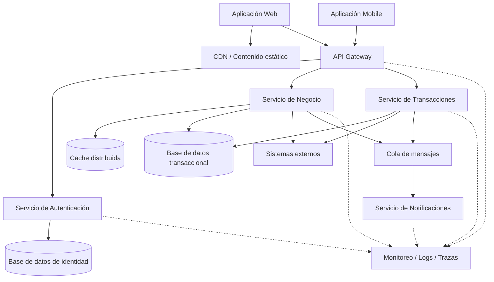

# Fase 2 — Definición de la arquitectura de software

## 1. Objetivo

En esta fase se propone una arquitectura que responda a los atributos de calidad identificados previamente.

Los tres principales drivers son:

- latencia máxima de 200 ms para operaciones mobile;
- disponibilidad mínima de 99.9 %;
- capacidad para soportar 10.000 usuarios concurrentes.

La intención no es seleccionar tecnologías únicamente por tendencia, sino definir una estructura que permita cumplir estos objetivos y que pueda evolucionar sin aumentar innecesariamente el acoplamiento entre componentes.

---

# 2. Patrón arquitectónico seleccionado

Se propone una **arquitectura orientada a servicios (SOA)**, utilizando servicios desacoplados con responsabilidades claras.

La decisión se toma principalmente porque permite separar capacidades del sistema que pueden tener comportamientos y necesidades de escalabilidad diferentes.

Por ejemplo, autenticación, procesamiento transaccional y notificaciones no necesariamente tienen la misma carga ni los mismos requerimientos operativos.

Separarlos permite escalar cada capacidad de manera independiente.

A nivel interno, cada servicio puede conservar una estructura por capas:

- capa de exposición;
- lógica de negocio;
- acceso a datos;
- infraestructura e integración.

De esta manera se combinan dos ideas:

- SOA para organizar las capacidades del sistema;
- arquitectura por capas dentro de cada servicio para mantener separación de responsabilidades.

---

# 3. Arquitectura propuesta

La solución se plantea de la siguiente manera:



---

# 4. Componentes principales

## 4.1 Aplicaciones Web y Mobile

Son los canales desde los cuales los usuarios consumirán las capacidades de la plataforma.

Aunque ambos canales consumen los mismos servicios de negocio, pueden tener necesidades diferentes.

En mobile, por ejemplo, la latencia y el consumo de datos tienen mayor relevancia.

Por esta razón se busca que las respuestas sean ligeras y que las APIs no devuelvan información innecesaria.

Para contenido estático de la aplicación web se puede utilizar una CDN, evitando que este tráfico llegue directamente a los servicios de negocio.

### Atributos relacionados

- Latencia
- Escalabilidad

---

## 4.2 API Gateway

El API Gateway actúa como punto de entrada hacia los servicios.

Sus principales responsabilidades serían:

- enrutamiento;
- validaciones generales;
- autenticación inicial;
- rate limiting;
- control de tráfico;
- versionamiento de APIs.

La lógica de negocio no debería implementarse en este componente.

El Gateway ayuda a evitar que los canales conozcan directamente la ubicación de cada servicio.

### Atributos relacionados

- Seguridad
- Escalabilidad
- Mantenibilidad
- Interoperabilidad

---

## 4.3 Servicio de Autenticación

Responsable de validar la identidad de los usuarios y gestionar la información necesaria para autorizar el acceso a los servicios.

Se separa del resto porque la autenticación es una capacidad transversal y puede recibir una carga diferente a la de los servicios de negocio.

### Atributos relacionados

- Seguridad
- Escalabilidad
- Disponibilidad

---

## 4.4 Servicio de Negocio

Representa las operaciones principales que no corresponden directamente al procesamiento transaccional.

Puede encargarse, por ejemplo, de consultas, validaciones o gestión de información del usuario.

Este servicio debe permanecer stateless siempre que sea posible para facilitar su escalamiento horizontal.

### Atributos relacionados

- Latencia
- Escalabilidad
- Mantenibilidad

---

## 4.5 Servicio de Transacciones

Se propone separar las operaciones transaccionales de otras capacidades porque suelen tener requisitos diferentes de consistencia, auditoría y disponibilidad.

Este servicio tendría la responsabilidad de:

- validar solicitudes;
- ejecutar operaciones transaccionales;
- persistir resultados;
- generar eventos posteriores cuando sea necesario.

Las operaciones que formen parte de la respuesta inmediata al usuario se procesan de forma síncrona.

Actividades posteriores, como notificaciones, pueden procesarse de manera asíncrona.

### Atributos relacionados

- Disponibilidad
- Latencia
- Resiliencia

---

## 4.6 Servicio de Notificaciones

Las notificaciones no deberían hacer parte del camino crítico de una transacción.

Por ejemplo, si una operación se ejecuta correctamente pero el proveedor de correo electrónico está temporalmente caído, esto no debería provocar el fallo de la operación original.

Por esta razón las notificaciones se procesan mediante una cola.

### Atributos relacionados

- Disponibilidad
- Resiliencia
- Escalabilidad

---

# 5. Estrategias para los atributos de calidad

## 5.1 Latencia

El objetivo definido para mobile es una respuesta máxima de 200 ms para las operaciones consideradas críticas.

Para reducir la latencia se plantean las siguientes decisiones:

### APIs ligeras

Los servicios deben devolver solamente la información requerida por el consumidor.

Esto reduce transferencia de datos y tiempo de serialización.

### Cache distribuida

Los datos de lectura frecuente que no cambien constantemente pueden almacenarse temporalmente en caché.

Esto evita realizar consultas repetitivas hacia la base de datos.

No toda información será candidata a caching, especialmente datos transaccionales o altamente variables.

### CDN

Los recursos estáticos de la aplicación web pueden distribuirse mediante CDN.

### Evitar cadenas largas de servicios

Una operación síncrona debería realizar la menor cantidad posible de saltos entre componentes.

Cada llamada adicional agrega latencia y otro posible punto de fallo.

### Operaciones asíncronas

Las actividades que no forman parte de la respuesta inmediata al usuario pueden ejecutarse mediante eventos o colas.

Ejemplo:

```text
Transacción
    ↓
Respuesta al usuario
    ↓
Evento
    ↓
Notificación
```

De esta forma, el envío de una notificación no aumenta el tiempo de respuesta de la transacción.

---

# 6. Estrategias de disponibilidad

Para alcanzar un SLA de 99.9 % se busca evitar que una única instancia sea responsable de una capacidad crítica.

## Múltiples instancias

Los servicios podrán ejecutar varias instancias detrás de un balanceador de carga.

Si una instancia falla, otra puede continuar procesando solicitudes.

## Health checks

Los componentes deben exponer mecanismos que permitan conocer si se encuentran disponibles para recibir tráfico.

## Replicación de base de datos

La base de datos transaccional debería contar con mecanismos de réplica y failover.

## Timeouts

Toda llamada a otro servicio debe tener un tiempo máximo de espera.

Esperar indefinidamente por una dependencia puede consumir recursos y terminar afectando a otros usuarios.

## Circuit Breaker

Cuando una dependencia presenta fallos repetidos, se puede interrumpir temporalmente el envío de nuevas solicitudes hacia ella.

Esto evita que el fallo se propague al resto de la plataforma.

## Retries controlados

Los reintentos se utilizarán únicamente para fallos que puedan ser transitorios.

No se deben realizar reintentos ilimitados.

Cuando sean necesarios, deberían utilizar mecanismos como:

- número máximo de intentos;
- exponential backoff;
- jitter.

---

# 7. Estrategias de escalabilidad

Para soportar hasta 10.000 usuarios concurrentes se plantea principalmente escalamiento horizontal.

## Servicios stateless

Los servicios no deberían mantener información de sesión únicamente en memoria local.

Esto permite agregar o eliminar instancias sin afectar al usuario.

## Auto-scaling

Las instancias pueden aumentar o disminuir según métricas como:

- número de solicitudes;
- CPU;
- memoria;
- profundidad de colas;
- tiempo de respuesta.

## Balanceo de carga

El tráfico se distribuye entre las diferentes instancias disponibles.

## Mensajería

Las colas permiten absorber picos de carga.

Si se generan más eventos de los que un consumidor puede procesar inmediatamente, estos pueden permanecer temporalmente en la cola mientras se incrementa la capacidad de procesamiento.

---

# 8. Persistencia

No se propone utilizar una única tecnología de almacenamiento para todos los casos sin conocer primero el tipo de información.

Como punto de partida se plantea una base de datos relacional para las operaciones transaccionales.

## Base de datos relacional

Se considera apropiada para operaciones donde se requiere:

- consistencia;
- integridad referencial;
- transacciones;
- auditoría.

Para soportar disponibilidad y escalabilidad se deberían considerar mecanismos como:

- replicación;
- read replicas;
- failover;
- índices adecuados;
- connection pooling.

En caso de que durante el análisis aparezcan casos con grandes volúmenes de datos no relacionales, podría evaluarse posteriormente una tecnología NoSQL.

No se considera necesario introducirla desde el inicio sin un requerimiento que lo justifique.

---

# 9. Comunicación entre servicios

Se plantean dos tipos de comunicación.

## Comunicación síncrona

Se utilizará cuando el usuario necesite conocer inmediatamente el resultado de una operación.

Ejemplo:

```text
Mobile
  ↓
API Gateway
  ↓
Servicio de Transacciones
  ↓
Base de datos
  ↓
Respuesta
```

Las APIs REST sobre HTTPS son una alternativa adecuada debido a su interoperabilidad y facilidad de consumo desde web y mobile.

---

## Comunicación asíncrona

Se utilizará cuando el procesamiento pueda realizarse después de responder al usuario.

Ejemplo:

```text
Servicio de Transacciones
          ↓
        Evento
          ↓
         Cola
          ↓
Servicio de Notificaciones
```

Esto permite desacoplar componentes y absorber picos de carga.

---

# 10. Estrategia de caching

El caching debe utilizarse de forma selectiva.

Puede ser útil para:

- catálogos;
- configuraciones;
- información consultada frecuentemente;
- datos con baja frecuencia de cambio.

No debería utilizarse de forma indiscriminada para información financiera o transaccional.

Cada dato almacenado en caché deberá tener una política de expiración definida.

---

# 11. Observabilidad

Todos los servicios deberían generar información suficiente para poder analizar su comportamiento.

Se plantean tres pilares:

### Logs

Registro estructurado de eventos y errores.

### Métricas

Como mínimo:

- cantidad de solicitudes;
- latencia;
- errores;
- CPU;
- memoria;
- uso de conexiones;
- tamaño de colas.

### Trazas

Cada solicitud debería contar con un identificador de correlación que permita seguir su recorrido entre servicios.

Esto será especialmente importante para validar el objetivo de latencia.

---

# 12. Estrategia de despliegue

Los servicios deberán poder desplegarse de forma independiente.

Se propone una plataforma basada en contenedores u otra alternativa que permita:

- múltiples instancias;
- health checks;
- auto-scaling;
- despliegues controlados;
- rollback.

Para reducir riesgos durante despliegues pueden utilizarse estrategias como:

- rolling deployment;
- blue/green;
- canary.

La elección concreta dependerá de la plataforma tecnológica utilizada.

---

# 13. Decisiones de arquitectura

## ADR-01 — Arquitectura orientada a servicios

### Decisión

Utilizar una arquitectura SOA con servicios desacoplados.

### Motivo

Permite separar capacidades con diferentes necesidades de escalamiento y evolución.

### Atributos favorecidos

- escalabilidad;
- disponibilidad;
- mantenibilidad.

### Trade-off

Aumenta la complejidad operacional respecto a una aplicación monolítica.

---

## ADR-02 — Servicios stateless

### Decisión

Evitar almacenar estado de usuario dentro de las instancias de servicio.

### Motivo

Permite agregar y retirar instancias sin depender de afinidad de sesión.

### Atributo favorecido

- escalabilidad.

---

## ADR-03 — Procesamiento asíncrono para operaciones secundarias

### Decisión

Utilizar mensajería para procesos que no requieren respuesta inmediata.

### Motivo

Reduce el camino crítico de las operaciones principales.

### Atributos favorecidos

- latencia;
- disponibilidad;
- escalabilidad.

### Trade-off

Introduce consistencia eventual y mayor complejidad de trazabilidad.

---

## ADR-04 — Base de datos relacional para operaciones transaccionales

### Decisión

Utilizar inicialmente persistencia relacional para información transaccional.

### Motivo

Este tipo de información requiere consistencia e integridad.

### Atributos favorecidos

- confiabilidad;
- mantenibilidad.

### Trade-off

El escalamiento horizontal de una base relacional puede requerir estrategias adicionales.

---

## ADR-05 — Uso selectivo de caché

### Decisión

Incorporar caché únicamente para información que pueda tolerar cierto nivel de desactualización.

### Motivo

Evitar accesos innecesarios a base de datos y mejorar tiempos de respuesta.

### Atributo favorecido

- latencia.

### Trade-off

Puede introducir datos temporalmente desactualizados.

---

## ADR-06 — Resiliencia en llamadas externas

### Decisión

Aplicar timeout, circuit breaker y retries controlados en dependencias externas.

### Motivo

Evitar que la caída o lentitud de otro sistema genere un fallo en cascada.

### Atributo favorecido

- disponibilidad.

---

# 14. Relación entre decisiones y atributos

| Decisión | Latencia | Disponibilidad | Escalabilidad |
|---|:---:|:---:|:---:|
| APIs ligeras | ✓ | | ✓ |
| CDN | ✓ | ✓ | ✓ |
| Caché | ✓ | | ✓ |
| Servicios stateless | | ✓ | ✓ |
| Balanceo de carga | | ✓ | ✓ |
| Auto-scaling | | ✓ | ✓ |
| Replicación de BD | | ✓ | ✓ |
| Message queues | ✓ | ✓ | ✓ |
| Circuit breaker | | ✓ | |
| Timeouts | ✓ | ✓ | |
| Observabilidad | ✓ | ✓ | ✓ |

---

# 15. Flujo de una operación crítica

Una operación transaccional tendría aproximadamente el siguiente recorrido:

```text
Usuario Mobile
      ↓
API Gateway
      ↓
Autenticación
      ↓
Servicio de Transacciones
      ↓
Base de datos
      ↓
Respuesta al usuario
```

Después de confirmar la transacción:

```text
Servicio de Transacciones
          ↓
        Evento
          ↓
         Cola
          ↓
Servicio de Notificaciones
```

De esta forma, únicamente los componentes necesarios permanecen dentro del camino crítico de los 200 ms.

---

# 16. Trade-offs de la solución

La propuesta mejora los atributos principales, pero también introduce compromisos.

### Mayor disponibilidad vs mayor costo

Mantener múltiples instancias y réplicas mejora disponibilidad, pero consume más infraestructura.

### Servicios distribuidos vs simplicidad

Separar capacidades permite escalarlas independientemente, pero aumenta la complejidad de operación y observabilidad.

### Procesamiento asíncrono vs consistencia inmediata

El uso de eventos reduce acoplamiento y mejora escalabilidad, pero introduce consistencia eventual.

### Caching vs actualidad de información

El caching mejora rendimiento, pero requiere controlar correctamente expiración e invalidación.

### Retries vs latencia

Los reintentos pueden resolver fallos temporales, pero si se utilizan sin control pueden aumentar la latencia e incluso agravar una falla.

---

# 17. Cómo se validará la arquitectura

La arquitectura propuesta todavía representa un diseño.

Para afirmar que cumple los atributos de calidad será necesario validarla mediante pruebas.

## Latencia

Realizar pruebas de rendimiento y medir como mínimo:

- p50;
- p95;
- p99.

Objetivo inicial:

**p95 ≤ 200 ms para operaciones mobile críticas.**

## Disponibilidad

Realizar pruebas de fallo controlado:

- detener una instancia;
- simular indisponibilidad de una dependencia;
- validar failover;
- verificar funcionamiento del circuit breaker.

## Escalabilidad

Realizar pruebas incrementales de carga hasta alcanzar:

**10.000 usuarios concurrentes.**

Durante la prueba se deberá verificar:

- latencia;
- error rate;
- CPU;
- memoria;
- conexiones a base de datos;
- comportamiento del auto-scaling.

---

# 18. Conclusión

La arquitectura propuesta utiliza un enfoque orientado a servicios porque permite separar capacidades y escalar aquellas que presentan mayor demanda.

La solución combina comunicación síncrona para las operaciones que requieren respuesta inmediata con procesamiento asíncrono para actividades secundarias.

Las decisiones principales buscan responder directamente a los atributos identificados:

- reducir el camino crítico y utilizar caching para mejorar latencia;
- utilizar redundancia, health checks y patrones de resiliencia para mejorar disponibilidad;
- utilizar servicios stateless, balanceo de carga, auto-scaling y mensajería para soportar crecimiento.

La arquitectura no pretende anticipar todas las tecnologías que podrían utilizarse. Las decisiones tecnológicas específicas deberán realizarse posteriormente teniendo en cuenta restricciones reales de infraestructura, costos, seguridad y operación.

Lo importante en esta fase es que cada decisión de diseño pueda relacionarse claramente con uno o más atributos de calidad y que posteriormente pueda ser validada mediante métricas y pruebas.